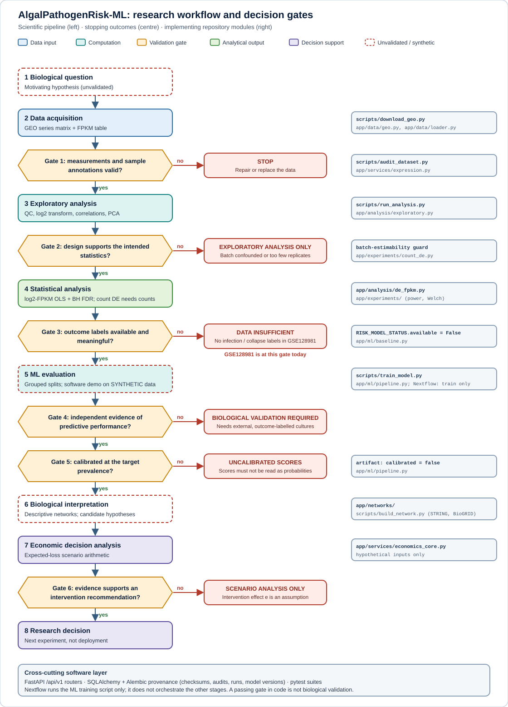
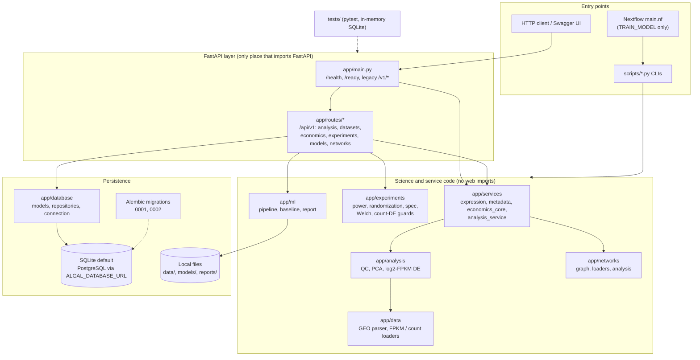
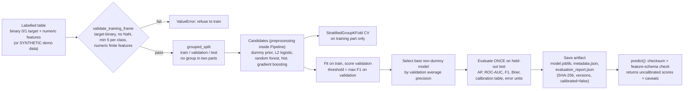
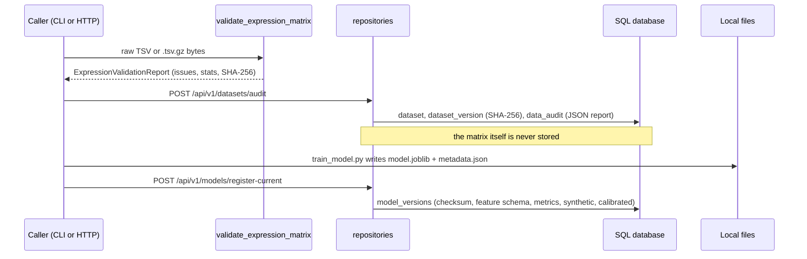

<p align="center">
  
</p>

# AlgalPathogenRisk-ML

**Transcriptomic analysis, leakage-aware machine learning and scenario-based decision support for early vulnerability assessment of microalgal cultures.**

> **Maturity: research prototype.** The software is a working scaffold for data audit, exploratory statistics, networks, ML evaluation, provenance storage and economic scenario arithmetic. It does **not** contain a validated pathogen-risk or culture-collapse model, and the only dataset analysed so far (GEO GSE128981) has no outcome labels to train one. See [Scope and limitations](#e-scope-and-limitations).

[](LICENSE)


**API and data** &nbsp;


**ML, networks, persistence** &nbsp;


**Workflow and quality** &nbsp;


Badges are static technology labels. No build, coverage or deployment badge is shown because none has been verified (the [CI workflow](.github/workflows/ci.yml) is configured but its status is not asserted here).

## Contents

[Executive summary](#b-executive-summary) · [Problem](#c-problem-statement-and-motivation) · [Research questions](#d-research-questions-and-objectives) · [Scope and limitations](#e-scope-and-limitations) · [Workflow](#f-scientific-and-computational-workflow) · [Architecture](#g-system-architecture) · [Repository](#h-repository-structure) · [Technology](#technology-stack) · [Methodology](#i-scientific-methodology) · [Data](#j-data-sources-and-provenance) · [Differential expression](#k-differential-expression-analysis) · [ML](#l-machine-learning-methodology) · [Scientific validity](#m-scientific-validity-and-evaluation) · [Networks](#n-biological-network-analysis) · [Experimental design](#o-experimental-design-and-statistical-power) · [Economics](#p-economic-decision-support) · [Install](#q-installation-and-environment-setup) · [Usage](#r-usage-examples) · [API](#s-api-reference) · [Database](#t-database-and-provenance) · [Nextflow](#u-nextflow-workflow) · [Testing](#v-testing-and-quality-assurance) · [Reproducibility](#w-reproducibility-and-model-artifacts) · [Security](#x-security-and-data-governance) · [References](#y-research-references-and-evidence) · [Roadmap](#z-roadmap-and-future-research) · [License and citation](#aa-contributing-license-and-citation)

## B. Executive summary

Commercial microalgal cultures can fail abruptly after environmental stress or disruption by pathogens, and a collapsed culture is costly. The motivating hypothesis of this project is that transcriptomic measurements taken before visible failure might carry a usable early-warning signal, and that such a signal could inform a cost-aware decision about preventive intervention. This is a hypothesis, not an established result.

The repository implements the computational scaffolding needed to test it responsibly: GEO ingestion and quality control, exploratory statistics, an OLS-based differential-expression comparison for FPKM data (with a guarded optional count-based path), provenance-tagged interaction networks, a leakage-aware ML pipeline, experiment-design and power tools, SQL provenance storage, a FastAPI service and expected-loss scenario calculations.

The most important limitation is data, not code: the supplied dataset (GSE128981, *Chlamydomonas reinhardtii* strain comparison for transgene silencing) contains **no infection or culture-collapse labels**. Consequently no pathogen-risk prediction is claimed, the ML pipeline has only been demonstrated on **synthetic** data, model scores are uncalibrated, and economic outputs are scenario arithmetic on hypothetical inputs.

## C. Problem statement and motivation

- **Biological context.** *Chlamydomonas reinhardtii* is a model green alga; the project uses it as the reference organism for transcriptomic analysis of cultures. Commercial cultivation exposes algae to environmental stress and possible pathogen-associated disruption.
- **Operational consequence.** A collapsed batch loses its expected output; earlier warning could in principle allow a cheaper intervention, but only if the warning is reliable.
- **Why transcriptomics.** Gene-expression profiles can change before a visible phenotype appears. That is a plausible motivation, not something this repository has demonstrated.
- **Association is not mechanism.** A gene that differs between groups, or that is central in an interaction network, is not thereby a cause of culture failure.
- **What useful decision support requires.** Biologically valid outcome labels, independent validation, calibrated probabilities at the relevant prevalence, and an economic model whose intervention-effect assumption is itself evidenced.

The literature supporting the *pathogen-collapse* motivation has **not yet been curated** in this repository (see [References](#y-research-references-and-evidence)); it is currently a stated hypothesis.

## D. Research questions and objectives

| Type | Question | Evidence needed |
|---|---|---|
| Biological | Do expression changes precede culture collapse under defined stress or infection? | Time-resolved, outcome-labelled cultures with controls; biosafety approval for any pathogen challenge |
| Statistical | Which genes differ between conditions once batch and replicate structure are respected? | Adequate independent replicates; batch-estimable design; correct input scale (counts for count models) |
| ML | Can expression features predict a defined collapse endpoint better than a baseline, on unseen cultures? | Binary or time-to-event labels, group-aware splits, independent external validation |
| Engineering | Can the analysis be audited and re-run reproducibly? | Checksums, seeds, version capture, passing test suite and CI on the target platform |
| Economic | Under what probability and effectiveness does intervention pay off? | Measured collapse costs, an evidenced intervention effect, calibrated probabilities |

## E. Scope and limitations

| Capability | Status | Available evidence | Outstanding validation |
|---|---|---|---|
| GEO series-matrix parser, QC, suitability audit | Implemented; validation pending | Unit tests incl. [real metadata fixture](tests/fixtures/GSE128981_series_matrix.txt); documented as executed on metadata and synthetic tables | Run on a real expression table |
| FPKM loader, exploratory QC/PCA | Implemented; validation pending | Documented as run on a synthetic fixture | Real GSE128981 FPKM file not inspected |
| log2-FPKM group comparison (OLS, BH) | Implemented; validation pending | Documented as matching SciPy's t test on synthetic input | Real data; assumptions check |
| Count-based DE (PyDESeq2) | Experimental | Design/estimability guards unit-tested; model call never run | Needs raw counts and PyDESeq2 run |
| Experiment design, power, randomization | Implemented; validation pending | Unit tests | None beyond local test run |
| Networks (STRING/BioGRID loaders, DE overlay) | Experimental | Synthetic files only | Real interaction files; ID mapping |
| ML train / evaluate / predict | Implemented; demonstrated on synthetic data only | Unit tests, synthetic demo | Real labelled data, external validation, calibration |
| **Pathogen-risk / collapse prediction** | **Not supported by available data** | `RISK_MODEL_STATUS.available = False`; guardrail test | Outcome-labelled experiments |
| Economics (break-even, sensitivity, Monte Carlo, EVPI) | Implemented; hypothetical inputs | Analytic unit checks | Measured costs and intervention effect |
| SQL provenance, Alembic migrations | Implemented; execution unconfirmed | Integration tests written | Run `pytest`; see [Database](#t-database-and-provenance) |
| FastAPI service | Implemented; HTTP layer execution unconfirmed | API tests written | Run `pytest` |
| Nextflow workflow | Experimental | Static only; not executed | Execute (`-stub-run`, then real run) |
| CI (GitHub Actions) | Configured; first run not confirmed | [Workflow](.github/workflows/ci.yml) exists | First run |

Evidence levels used throughout: **(1)** implemented software capability, **(2)** demonstrated on synthetic data, **(3)** exploratory analysis supported by real data, **(4)** hypothesis needing experiments, **(5)** biological validation (none established). The authors' own status record is [docs/implementation_status.md](docs/implementation_status.md); it states that the HTTP layer, SQL/Alembic, Nextflow, CI, ruff/mypy and PyDESeq2 had not been executed when it was written.

## F. Scientific and computational workflow

<p align="center">
  
</p>

*Figure 1. The **research workflow** (what a sound study would do) with the repository modules that implement each stage. It is not a description of one automated pipeline: stages are run by separate scripts or API calls, and Nextflow wraps only model training. For GSE128981 the risk-prediction path ends at Gate 3.*

| Stage | Inputs | Transformation | Validation requirement | Outputs |
|---|---|---|---|---|
| 1 Question | Hypothesis | Define endpoint and horizon | Endpoint measurable | Study aim |
| 2 Acquisition | GEO series matrix, supplementary table | Download, checksum | Provenance recorded | Local files, SHA-256 |
| Gate 1 | Matrix, sample sheet | Format, ID, NaN, negative-value checks | IDs unique and aligned | Audit report |
| 3 Exploration | Expression table | log2(x+1), correlations, PCA | Outlier and correlation flags | QC tables, plots |
| Gate 2 | Metadata | Replicate count, batch estimability | Contrast separable from batch | Allow / refuse |
| 4 Statistics | log2 FPKM or counts | Per-gene model, BH FDR | Correct scale and assumptions | Ranked gene table |
| Gate 3 | Labels | Check outcome labels exist | Biologically meaningful labels | Proceed or `DATA INSUFFICIENT` |
| 5 ML | Labelled table | Grouped splits, candidates | No leakage; baseline compared | Artifact + report |
| Gates 4-5 | Held-out data | Independent evidence, calibration | External validation; prevalence | Validated claim or stop |
| 6 Interpretation | DE table, edges | Descriptive network overlay | Provenance per edge | Hypotheses |
| 7-8 Economics, decision | p, L, C, e | Expected-loss arithmetic | Evidenced effect e | Scenario table |

## G. System architecture



*Figure 2. Module dependencies as found in the imports. A grep of `app/` shows FastAPI is imported only in `app/main.py` and `app/routes/`. `app/main.py` also calls `app.ml.pipeline` (for `/ready`) and keeps three legacy routes. Large matrices, models and graphs stay on disk; SQL stores checksums, audits, runs, plans, scenarios, model versions and network metadata.*

## H. Repository structure

```text
AlgalPathogenRisk-ML/
├── app/
│   ├── main.py            # FastAPI app, /health, /ready, legacy /v1 routes
│   ├── config.py          # ALGAL_* environment settings (validated)
│   ├── schemas.py, schemas_v1.py   # Pydantic request/response models
│   ├── analysis/          # exploratory QC/PCA, log2-FPKM differential expression
│   ├── data/              # GEO series-matrix parser, FPKM and count loaders
│   ├── database/          # SQLAlchemy models, repositories, engine, migrate helper
│   ├── experiments/       # power, randomization, spec, Welch/BH, count-DE guards
│   ├── ml/                # pipeline (train/predict/artifacts), baseline, report
│   ├── networks/          # evidence-tagged graph, STRING/BioGRID loaders, analysis
│   ├── routes/            # /api/v1 routers
│   └── services/          # expression validation, metadata audit, economics, payload logic
├── scripts/               # CLIs (audit, analysis, training, networks, downloads, DB upgrade)
├── tests/                 # unit/, integration/, api/, scientific_validity/, fixtures/
├── migrations/            # Alembic environment and revisions 0001, 0002
├── workflows/nextflow/    # main.nf, nextflow.config
├── configs/project.yaml   # dataset/scope declarations
├── data/                  # metadata/ tracked; raw/, interim/, processed/ git-ignored
├── docs/                  # MkDocs sources and docs/assets (README figures)
├── references/            # references.json register and notes
├── models/, reports/      # generated output (git-ignored)
└── pyproject.toml, requirements.txt, alembic.ini, mkdocs.yml, .env.example
```

| Path | Responsibility |
|---|---|
| `app/data/geo.py` | Parse series matrix, classify measurement type, expression QC, suitability statement |
| `app/services/expression.py` | Byte-level validation of an uploaded TSV/`.tsv.gz` (size limits, IDs, non-numeric, negatives) |
| `app/analysis/de_fpkm.py` | Per-gene OLS on log2(FPKM+c), optional batch term, BH, Hedges' g |
| `app/experiments/count_de.py` | Raw-count checks, estimability of contrasts under batch, optional PyDESeq2 call |
| `app/ml/pipeline.py` | Grouped splits, candidate models, threshold choice, artifacts, checksummed prediction |
| `app/ml/baseline.py` | Genotype-label baseline and `RISK_MODEL_STATUS` (states no risk model exists) |
| `app/networks/` | Edge provenance rules, loaders, descriptive metrics, DE overlay |
| `app/services/economics_core.py` | Expected loss, net benefit, break-even, sensitivity, Monte Carlo, EVPI |
| `app/database/` | Provenance schema and repositories (no matrices stored) |
| `tests/scientific_validity/` | Guardrails that fail if a risk model is claimed or biosafety is omitted from a plan |

Excluded from the tree: `.venv/`, caches, `*.db`, generated models/reports, local raw data. A packaging artefact `algae_culture_risk_prototype.egg-info/` is present in the supplied archive although `.gitignore` lists `*.egg-info/`; check `git ls-files` and untrack it if it is committed.

## Technology stack

| Category | Technology (verified in `pyproject.toml`) | Purpose here |
|---|---|---|
| Language | Python ≥ 3.11 (CI: 3.11, 3.12) | All code |
| API | FastAPI, Uvicorn, Pydantic v2 | HTTP service and request validation |
| Scientific computing | NumPy, pandas, SciPy, Matplotlib | Tables, linear algebra, t / noncentral-t, QC plots |
| Machine learning | scikit-learn, joblib | Pipelines, grouped CV, metrics, artifact serialization |
| Statistics | SciPy; own OLS, BH, Hedges' g; optional PyDESeq2 (`[de]`) | log2-FPKM comparison, power, count DE |
| Networks | NetworkX | MultiGraph, components, betweenness, GraphML |
| Persistence | SQLAlchemy 2, Alembic; SQLite default, PostgreSQL optional (`[postgres]`) | Provenance records |
| Orchestration | Nextflow (optional) | One process: `TRAIN_MODEL` |
| Testing | pytest, pytest-cov, httpx (FastAPI TestClient) | Unit, API, integration, guardrail tests |
| Code quality | Ruff (in CI); mypy configured (not in CI) | Lint, typing |
| Documentation | MkDocs Material | `docs/` site |
| CI/CD | GitHub Actions `ci.yml`: ruff, pytest with coverage, `mkdocs build --strict` | Automated checks (not yet confirmed run) |
| Packaging | setuptools (`setuptools>=69`), package `algae-culture-risk-prototype` 0.1.0 | Editable install |

## I. Scientific methodology

| Method | Implemented (what the code does) | Not implemented / recommendation only |
|---|---|---|
| Expression-matrix validation | `app/services/expression.py`: gzip-bomb guard (25 MiB upload, 200 MiB decompressed), UTF-8 TSV, missing/duplicate gene and sample IDs, blank, non-numeric, infinite and negative cells, SHA-256; assumes genes in rows | Gene-ID mapping against an annotation |
| Sample metadata | `app/services/metadata.py`, `scripts/audit_geo_matrix.py`: parse `!Sample_*` and characteristics, write manifests; GSE128981 batch **inferred** from accession block and design text | Authoritative batch from the submitters |
| Exploratory analysis | log2(FPKM+1), per-sample detection, sample correlations, PCA (top variable genes), box/PCA plots | Formal outlier handling |
| Differential expression | See [section K](#k-differential-expression-analysis) | Moderated variance (limma-style), count models on real counts |
| Feature processing | Median imputation and scaling inside sklearn `Pipeline` | Feature selection step (none is implemented) |
| ML | See [section L](#l-machine-learning-methodology) | Calibration, nested CV, confidence intervals |
| Networks | See [section N](#n-biological-network-analysis) | Enrichment with a proper background universe |
| Design and power | See [section O](#o-experimental-design-and-statistical-power) | Simulation-based power for time-to-event |
| Economics | See [section P](#p-economic-decision-support) | Empirical cost and effectiveness inputs |

## J. Data sources and provenance

**GSE128981** ([GEO record](https://www.ncbi.nlm.nih.gov/geo/query/acc.cgi?acc=GSE128981)): "RNA-Seq expression profiling of srta mutant and WT strains of *Chlamydomonas reinhardtii*". Facts confirmed from the supplied series-matrix file and the committed manifests:

- 21 samples (GSM3689501-GSM3689512, GSM4733487-GSM4733495), platform GPL26362, taxid 3055, Illumina HiSeq 4000.
- Strains: Elow47 (wild-type parent, 4), UVM4 (4), UVM11 (7), UVM11-C1 (3), UVM11-C9 (3).
- The submitters describe two sequencing batches. The per-sample batch labels in `data/metadata/` are **inferred** by this project (`batch_source` column) and are confounded with strain: Elow47 and UVM4 are only in batch 1, C1 and C9 only in batch 2, UVM11 in both.
- The series-matrix file shipped here has **no expression values** (`!Sample_data_row_count` is 0 and the table block is empty). The header lists a supplementary file, `GSE128981_FPKMs.replicates.v2.tsv.gz`, which has **not been inspected** in this repository; its columns, annotation columns and gene identifiers require verification.
- The study (PMID 33293544) concerns transgene silencing by a sirtuin-type histone deacetylase [[R1](#y-research-references-and-evidence)]. It contains no pathogen or collapse outcome.

| Term | Meaning |
|---|---|
| GEO series matrix | Text file of series and sample **metadata**, optionally with a processed table; here the table is empty |
| Raw sequencing reads | FASTQ files (SRA); the starting point for counting |
| Count matrix | Integer reads per gene per sample; required by negative-binomial methods |
| Normalized values (FPKM/TPM) | Length- and depth-scaled abundances; not counts; the supplementary file is described as FPKM |

| Item | Role | Path / script |
|---|---|---|
| Series matrix (metadata) | Parsing and audit | `data/raw/GSE128981_series_matrix.txt[.gz]` (git-ignored); fixture in `tests/fixtures/` |
| Sample manifests | Strain, inferred batch, growth condition | `data/metadata/sample_manifest.csv`, `sample_metadata_gsm.csv`, `sample_metadata_title.csv` |
| FPKM table | Exploratory analysis | `scripts/download_geo.py` (needs network; records SHA-256) |
| Interaction files | STRING links / BioGRID TAB3 | `scripts/download_interactions.py` (default URL unverified; `--url` override), BioGRID manual download |
| Synthetic fixtures | Software tests only | `tests/fixtures/SYNTHETIC_fpkm_gse128981_layout.tsv`, `make_demo_dataset` |

Raw data are not committed. Check [GEO's terms](https://www.ncbi.nlm.nih.gov/geo/info/disclaimer.html) before redistributing files, and cite the dataset and its publication.

## K. Differential-expression analysis

`app/analysis/de_fpkm.py` (CLI: `scripts/run_analysis.py --contrast`; API: `POST /api/v1/analysis/differential-expression`).

- **Input scale:** FPKM, genes × samples, finite and non-negative. FPKM is not a count.
- **Model:** per gene, ordinary least squares on log2(FPKM + 1) with a group term and, when estimable, batch indicators; t test on the group term; equal-variance, independent-replicate assumptions. With one batch and two groups it equals Student's t test.
- **Filtering:** gene kept if FPKM ≥ 1 in at least 2 selected samples; at least 2 samples per group.
- **Normalization:** none beyond the FPKM scaling already applied upstream.
- **Multiple testing:** Benjamini-Hochberg (`padj_bh`) [[R5](#y-research-references-and-evidence)].
- **Effect sizes:** difference of mean log2 values (a − b) with 95% CI, Hedges' g. The "log2 fold change" is damped for low genes by the pseudocount.
- **Guard:** a contrast that cannot be separated from batch raises `ConfoundingError` (CLI exit code 3; API 409) unless `--allow-unadjusted` is used, which flags `batch_confounded`.
- **Count-based DE** (`scripts/run_count_de.py`, optional `pip install -e ".[de]"`) refuses non-count input and non-estimable contrasts; the PyDESeq2 model call [[R3](#y-research-references-and-evidence), [R4](#y-research-references-and-evidence)] has never been executed by the authors and no raw counts are in the repository.
- **Interpretation:** a differentially expressed gene is an observational difference between strains. It is not evidence of causation and says nothing about infection or collapse risk.

## L. Machine-learning methodology

`app/ml/pipeline.py`, driven by `scripts/train_model.py` or `POST /api/v1/models/train-demo`.



*Figure 3. ML training and evaluation flow as implemented.*

| Item | Implementation |
|---|---|
| Target | Binary 0/1 column (`--target`, default `label`); must be supplied by the caller |
| Features | All other numeric columns except the group column |
| Splits | `GroupShuffleSplit` 25% test, 25% validation; replicates sharing a group id never cross parts; each part must contain both classes |
| Preprocessing | Median imputation and standardization inside each pipeline (fit on training data only) |
| Feature selection | None |
| Models | Dummy prior, L2 logistic regression, random forest, histogram gradient boosting |
| Hyperparameters | Fixed defaults in `candidate_models`; no tuning search |
| Selection / threshold | Best non-dummy model by validation average precision; threshold maximizes F1 on validation |
| Metrics | ROC-AUC, average precision, precision, recall, specificity, F1, Brier, confusion matrix, quantile calibration table, dummy baseline on the same test set |
| Calibration | **Not performed**; artifacts carry `calibrated: false` |
| Persistence | `model.joblib`, `metadata.json` (SHA-256, seed, config, data hash, library versions), `evaluation_report.json`; load verifies checksum and scikit-learn major version |
| Inference | Records must match the stored feature schema exactly (missing/extra/non-numeric/infinite rejected); response includes caveats |

> **Warning.** `--demo` and `train-demo` use **synthetic** data (label planted in two features). Their metrics show that the software runs. They are not biological evidence, and the resulting scores are not probabilities of infection or collapse. `app/ml/baseline.py` can also evaluate a genotype label on a small matrix, which is explicitly not risk prediction.

## M. Scientific validity and evaluation

| Requirement for real predictive value | Status in this repository |
|---|---|
| Biologically valid outcome labels, defined horizon | **Absent** (none in GSE128981) |
| Controls and independent biological units | Design tooling exists ([section O](#o-experimental-design-and-statistical-power)); no such data |
| Leakage-resistant partitioning | Implemented (group-aware splits, in-pipeline preprocessing, test used once); tested on synthetic data |
| Independent / external validation | Not implemented, no data |
| Class imbalance, precision-recall | Average precision, balanced class weights for some models; synthetic only |
| Calibration and Brier score | Brier and a reliability table are computed; no calibration step, no calibration claim |
| Uncertainty (confidence intervals) | CV mean ± SD of average precision only; no intervals on test metrics |
| Prevalence shift | Not handled; thresholds depend on training prevalence |
| Small-sample limits | Minimum 5 per class enforced; the 21-sample GSE128981 is far too small and unlabelled for this purpose |
| Reproducibility, sensitivity analysis | Seeds fixed; no sensitivity analysis |

Replicates of one strain are not independent of strain identity, so cross-validation within GSE128981 would estimate recognition of *seen* strains, not generalization to new cultures.

## N. Biological network analysis

- **Representation:** `networkx.MultiGraph`; nodes are gene/protein identifiers; each edge requires `source_db`, `source_version`, `interaction_type` and `evidence_type` (`experimental`, `curated`, `predicted`, `text_mining`); optional `confidence` in [0, 1] (stored as -1 when not reported). Self-loops and duplicate edges are rejected.
- **Inputs:** STRING `links[.detailed]` files (`load_string_links`; `build_network.py --min-score` default 700) and BioGRID TAB3 (`load_biogrid_tab3`), supplied by the user; no interaction data is bundled or fetched by the API.
- **Algorithms:** degree, components, density, betweenness (sampled above 3,000 nodes), neighbourhoods, confidence filtering, and a DE overlay that finds connected components among significant genes and compares edge counts with seeded random gene sets (1,000 permutations by default).
- **Outputs:** GraphML plus a JSON/Markdown report; `expression_overlap` reports identifier mismatches with the expression table.
- **Interpretation:** a computational association network, not a validated pathway. Centrality does not imply causation, and STRING/BioGRID loaders have been run only on synthetic files.

## O. Experimental design and statistical power

- **Spec** (`ExperimentSpec`): requires objective, hypothesis, endpoint, experimental unit, replicate definition, ≥ 2 groups with a control, primary analysis, sample-size rationale, randomization method and a **biosafety statement**; status defaults to `planned_not_executed`.
- **Randomization:** seeded, balanced assignment of unique biological units; optional permuted blocks; repeated unit IDs (technical replicates) are rejected.
- **Power:** two-group continuous endpoint via the exact noncentral-t power of a pooled t test (optional Bonferroni `n_comparisons`), and two proportions via Cohen's h normal approximation [[R10](#y-research-references-and-evidence)]; attrition inflates enrolment. Time-to-event is **not** supported and returns an explicit error.
- **Analysis:** Welch two-group test with CI, and BH.
- All inputs (effect size, alpha, power) are caller assumptions. The repository ships no recommended sample size.

## P. Economic decision support

`app/services/economics_core.py` (one cycle; p = baseline failure probability, L = loss on failure, C = intervention cost, e = relative reduction in failure probability so that p → p(1 − e)):

```text
EL(no intervention) = p · L
EL(intervention)    = C + p(1 − e) · L
Net benefit         = EL(no) − EL(intervention) = p · e · L − C
Break-even p*       = C / (e · L)
```

Also provided: sensitivity grid, exact net-benefit bounds, Monte Carlo over **assumed** uniform ranges with expected value of perfect information, and intervention ranking. Worked example (hypothetical inputs p=0.10, L=100000, C=3000, e=0.5): EL(no)=10000, EL(intervention)=8000, net benefit=2000, p*=0.06 (computed with the module).

The benefit depends on the intervention's real effect `e`, its cost and the loss on failure. With `e` unknown, results are **scenario analysis**, not evidence of efficacy. A model score is not a calibrated probability merely because it can be entered as `p`.

## Q. Installation and environment setup

Requires Python ≥ 3.11. Java and Nextflow are needed only for the optional workflow.

**Windows PowerShell**

```powershell
py -3.12 -m venv .venv
.\.venv\Scripts\Activate.ps1
python -m pip install --upgrade pip
pip install -e ".[dev]"          # add ,de for PyDESeq2 or ,postgres for psycopg2
Copy-Item .env.example .env
```

**Linux / WSL2**

```bash
python3 -m venv .venv && source .venv/bin/activate
python -m pip install --upgrade pip
pip install -e ".[dev]"
cp .env.example .env
```

Settings (`app/config.py`) are read from process environment variables: `ALGAL_ENV` (`development|production|test`), `ALGAL_DATABASE_URL` (`sqlite://` or `postgresql://`; default `sqlite:///./algal.db`), `ALGAL_LOG_LEVEL`, `ALGAL_MODEL_DIR` (default `models/current`). The application code does not load `.env` itself; export the variables or start Uvicorn with `--env-file .env` (python-dotenv, installed by `uvicorn[standard]`). `.env` is git-ignored; never commit it or a virtual environment. No secrets are required by the defaults.

Initialize or upgrade the schema (see [Database](#t-database-and-provenance)): `python scripts/db_upgrade.py`.

Optional workflow: install Java and [Nextflow](https://www.nextflow.io/) (≥ 23.04) inside WSL2 or Linux.

## R. Usage examples

Each command was checked against the script's argument parser (`--help` was run for every script with arguments except `db_upgrade.py`, which needs SQLAlchemy/Alembic installed; `make_synthetic_fixture.py` takes no arguments). Paths use PowerShell; on Linux use `/` and `\` → `/`.

```powershell
# 1. Audit GEO metadata and write sample manifests
python scripts\audit_geo_matrix.py --input data\raw\GSE128981_series_matrix.txt.gz --manifest-dir data\metadata --gse128981-batch-rule
python scripts\audit_dataset.py --series-matrix data\raw\GSE128981_series_matrix.txt.gz --out reports\audit

# 2. Download the supplementary FPKM file (network; records SHA-256)
python scripts\download_geo.py --out data\raw

# 3. Exploratory analysis and log2-FPKM contrast (exit 3 = refused: batch-confounded)
python scripts\run_analysis.py --fpkm data\raw\GSE128981_FPKMs.replicates.v2.tsv.gz --metadata data\metadata\sample_metadata_gsm.csv --out reports\exploratory --contrast UVM4 Elow47 --batch-col batch

# 4. SYNTHETIC model demonstration, then a Markdown report
python scripts\train_model.py --demo --out models\current --report reports\model_report.json
python scripts\make_model_report.py --artifact-dir models\current --out reports\model_report.md

# 5. Network from files you downloaded (STRING and/or BioGRID)
python scripts\build_network.py --string links.txt.gz --string-version v12.0 --expression data\raw\GSE128981_FPKMs.replicates.v2.tsv.gz --out reports\network

# 6. Count-based DE (needs RAW counts and `pip install -e ".[de]"`)
python scripts\run_count_de.py --counts counts.tsv --metadata data\metadata\sample_manifest.csv --group-col strain --batch-col batch --list-estimable

# 7. Database and API
python scripts\db_upgrade.py
uvicorn app.main:app --reload
```

Note that `run_analysis.py` expects a metadata CSV with `sample_id` and `group` (optional `batch`), which matches `sample_metadata_gsm.csv`. The `scripts/make_synthetic_fixture.py` script rewrites the synthetic FPKM fixture under `tests/fixtures/`.

## S. API reference

Local development only: Swagger UI <http://127.0.0.1:8000/docs>, OpenAPI schema <http://127.0.0.1:8000/openapi.json>. There is no public deployment. Unhandled errors return `500 {"detail": "Internal server error."}`.

| Method and path | Purpose | Inputs | Errors |
|---|---|---|---|
| `GET /health` | Liveness; reports `risk_model_loaded: false`, `biological_validation: not_established` | none | |
| `GET /ready` | Component status, model artifact metadata, GEO file presence | none | |
| `GET /v1/datasets/GSE128981/audit` | Legacy: audit `data/raw/GSE128981_series_matrix.txt` (uncompressed path) | none | 404 if file absent |
| `POST /v1/economics/break-even` | Legacy break-even | `intervention_cost`, `collapse_loss`, `intervention_effectiveness`, `baseline_collapse_probability`, `pilot_batches` | 422 |
| `POST /v1/expression-matrices/validate` | Validate raw TSV/`.tsv.gz` body | raw bytes | 400 empty/unparseable, 413 > 25 MiB |
| `POST /api/v1/analysis/differential-expression` | log2-FPKM OLS + BH | `gene_ids`, `sample_ids`, `values`, `groups`, `group_a`, `group_b`, optional `batches`, `top_n` | 409 confounded, 422 |
| `GET /api/v1/datasets`, `GET /api/v1/datasets/{id}` | List / fetch registered datasets | | 404 |
| `POST /api/v1/datasets/audit?accession=&file_name=` | Validate raw body, record version + audit (matrix not stored) | raw bytes | 400, 413 |
| `POST /api/v1/economics/break-even` | Expected loss, net benefit, break-even; optional `save_as` | `p`, `L`, `C`, `e`, `cycles` | 409 duplicate name, 422 |
| `POST /api/v1/economics/sensitivity` | Net-benefit grid (≤ 10,000 cells) | `L`, `C`, `p_values`, `e_values` | 422 |
| `POST /api/v1/economics/uncertainty` | Monte Carlo + EVPI over assumed ranges | `p`, `L`, `C`, `e` as `[low, high]`, `n`, `seed` | 422 |
| `POST /api/v1/experiments/design` | Validate and optionally save a plan (YAML returned) | spec fields | 422 lists missing items, 409 |
| `POST /api/v1/experiments/power-analysis` | Sample size | `endpoint`, `effect_size_d` or `p1`/`p2`, `alpha`, `power` | 422 (e.g. time-to-event) |
| `POST /api/v1/experiments/randomize` | Seeded assignment | `unit_ids`, `groups`, `seed`, `blocks` | 422 |
| `POST /api/v1/experiments/analyze` | Welch test with CI | `values`, `groups`, `group_a`, `group_b` | 422 |
| `GET /api/v1/models/status` | States no risk model exists | | |
| `POST /api/v1/models/evaluate` | Genotype-baseline CV (≤ 500 × 5,000) | `matrix`, `labels`, `groups` | 422 |
| `POST /api/v1/models/train-demo` | Train on SYNTHETIC data, write artifact | `seed`, `n_groups` (20-500) | 422 |
| `GET /api/v1/models/current` | Artifact metadata | | 404 |
| `POST /api/v1/models/predict` | Uncalibrated scores for `records` | list of feature dicts | 404, 422 |
| `POST /api/v1/models/register-current`, `GET /api/v1/models/versions` | Record / list artifact versions | | 404 |
| `GET /api/v1/networks/status`, `POST /api/v1/networks/summary` | Loader status; summarize a supplied edge list | `edges`, `source_db`, `source_version` | 422 |

Example (field names from `app/schemas_v1.py`; response keys from `routes/economics.py`; PowerShell):

```powershell
Invoke-RestMethod -Method Post -Uri http://127.0.0.1:8000/api/v1/economics/break-even -ContentType application/json -Body '{"p":0.1,"L":100000,"C":3000,"e":0.5}'
# keys: expected_loss_without, expected_cost_with, net_benefit_per_cycle, net_benefit_total, break_even, assumptions, disclaimer
```

## T. Database and provenance

- **Entities** (`app/database/models.py`): `datasets`, `dataset_versions` (unique per SHA-256), `data_audits`, `analysis_runs`, `model_evaluations`, `experiments`, `economic_scenarios`, `reference_records`, `model_versions`, `network_records`. Matrices, models and graphs stay on disk.
- **Backend:** SQLite by default (`sqlite:///./algal.db`, foreign keys enabled); PostgreSQL URLs accepted (`[postgres]` extra). Tests use in-memory SQLite.
- **Two schema paths:** the API engine calls `Base.metadata.create_all` on first use, while Alembic revisions `0001` (initial) and `0002` (model_versions, network_records) are applied by `python scripts/db_upgrade.py [--url URL] [--revision head]`. Pick one per database: running migrations on a database the API already populated would try to create existing tables; with a current ORM schema `alembic stamp head` marks it as migrated (standard Alembic behaviour, not executed here).
- **Caution:** `migrations/env.py` reads `sqlalchemy.url` from the Alembic config, which `alembic.ini` leaves empty and which is not filled from `ALGAL_DATABASE_URL`. The wrapper `scripts/db_upgrade.py` supplies the URL; a bare `alembic upgrade head` as shown in `docs/database_migrations.md` is therefore likely to fail unless a URL is provided. Not executed (Alembic not installed in the review environment).



*Figure 4. Dataset-audit and model-artifact provenance lifecycle.*

## U. Nextflow workflow

`workflows/nextflow/main.nf` defines one process, **`TRAIN_MODEL`**, which runs `scripts/train_model.py`. It does not run auditing, DE, networks or economics.

| Item | Detail |
|---|---|
| Parameters | `--csv` (labelled CSV), `--demo` (SYNTHETIC data), `--target` (`label`), `--group` (`group`), `--seed` (42), `--outdir` (`results`) |
| Inputs | `--csv` file, or `--demo true` (a placeholder file is passed; data are generated) |
| Execution | `python` from `PATH` (an environment with the project installed); `cpus 1`, `memory 2 GB`; `errorStrategy 'terminate'`; profile `local` |
| Outputs | `model/*` and `report.json`, copied into `--outdir` |
| Ignored by Git | `work/`, `.nextflow*`, `results/` |

```bash
nextflow run workflows/nextflow/main.nf --demo true --outdir results      # Linux / WSL2
```

Status: **never executed** by the authors. Standard Nextflow flags such as `-with-report` and `-with-trace` can inspect a run. No container or portability is claimed; run it in Linux or WSL2 with the Python environment active.

## V. Testing and quality assurance

| Area | Location |
|---|---|
| Unit | `tests/unit/` (parsers, DE, power, randomization, networks, economics, ML, CLIs via subprocess) |
| API | `tests/api/`, `tests/test_api.py`, `tests/test_ml_api.py` (TestClient, in-memory SQLite) |
| Integration | `tests/integration/` (database, repositories, migrations) |
| Scientific validity | `tests/scientific_validity/test_guardrails.py` |

```powershell
pytest --cov=app --cov-report=term-missing
ruff check app tests scripts
mypy                       # configured in pyproject.toml; not part of CI
mkdocs build --strict
```

A static count finds 117 `test_` functions; this is not a pass count. No test results, coverage figure or CI status are reported here: run the commands above to generate them. The authors' notes record that a stand-in runner passed 82 tests that do not need FastAPI/SQLAlchemy, and that API and integration tests were not executed.

## W. Reproducibility and model artifacts

- **Seeds:** explicit for splits, CV, PCA, randomization, permutation tests and Monte Carlo (default 42 or as given).
- **Dependencies:** bounded ranges in `pyproject.toml`; hash-pinned lockfiles can be generated with `scripts/lock_dependencies.ps1` (none committed).
- **Artifacts:** `model.joblib`, `metadata.json`, `evaluation_report.json` with SHA-256, data hash, config and library versions; loading fails on checksum or scikit-learn major-version mismatch. `joblib` files can execute code when loaded: load only your own artifacts.
- **Logs and outputs:** `reports/` and `models/` are git-ignored.
- **Boundary:** re-running synthetic tests reproduces *software* behaviour. It says nothing about reproducibility of biological findings, which needs real, independent data.

## X. Security and data governance

- Configuration comes from environment variables; keep `.env` local and out of Git. Documentation examples contain no credentials.
- Commit: source, tests, small metadata, synthetic fixtures, docs. Keep local: `.env`, `.venv/`, `data/raw|interim|processed`, `models/`, `reports/`, `*.db`, `work/`, `results/`.
- Uploads are size-limited (25 MiB; 200 MiB after decompression) and parsed as text; server errors are logged, not returned to clients.
- Treat downloaded interaction files and any model artifact as untrusted input until verified by checksum.
- The API has **no authentication**; do not expose it beyond localhost without adding it.
- Any pathogen-challenge experiment needs biosafety and institutional approval (`biosafety_statement` is mandatory in plans).

## Y. Research references and evidence

Verification column: **checked** = confirmed against a publisher/primary record during this documentation pass; **recorded** = taken from [references/references.json](references/references.json) and not re-checked.

| ID | Source | Supports | Verification |
|---|---|---|---|
| R1 | Neupert J, Gallaher SD, Lu Y, et al. An epigenetic gene silencing pathway selectively acting on transgenic DNA in the green alga *Chlamydomonas*. *Nat Commun* 2020;11:6269. [doi:10.1038/s41467-020-19983-4](https://doi.org/10.1038/s41467-020-19983-4); a [publisher correction](https://doi.org/10.1038/s41467-020-20623-0) exists | Publication associated with GSE128981 (transgene silencing) | checked |
| R2 | NCBI GEO [GSE128981](https://www.ncbi.nlm.nih.gov/geo/query/acc.cgi?acc=GSE128981) | Dataset provenance | header parsed from the supplied file |
| R3 | Love MI, Huber W, Anders S. *Genome Biol* 2014;15:550. doi:10.1186/s13059-014-0550-8 | Count-based DE (DESeq2) | recorded |
| R4 | Muzellec B, Teleńczuk M, Cabeli V, Andreux M. PyDESeq2. *Bioinformatics* 2023;39(9). [doi:10.1093/bioinformatics/btad547](https://doi.org/10.1093/bioinformatics/btad547) | Optional count-DE implementation | checked |
| R5 | Benjamini Y, Hochberg Y. *J R Stat Soc B* 1995;57:289-300. doi:10.1111/j.2517-6161.1995.tb02031.x | FDR correction | recorded |
| R6 | Leek JT et al. *Nat Rev Genet* 2010;11:733-739. doi:10.1038/nrg2825 | Batch-effect caution | recorded |
| R7 | Conesa A et al. *Genome Biol* 2016;17:13. doi:10.1186/s13059-016-0881-8 | RNA-seq practice | recorded |
| R8 | Kapoor S, Narayanan A. Leakage and the reproducibility crisis in ML-based science. *Patterns* 2023 | Leakage framing | recorded (volume/DOI not recorded) |
| R9 | Niculescu-Mizil A, Caruana R. Predicting good probabilities with supervised learning. ICML 2005 | Calibration | recorded |
| R10 | Cohen J. *Statistical Power Analysis for the Behavioral Sciences*, 2nd ed., 1988 | Effect sizes d, h | recorded |
| R11 | Szklarczyk D et al. The STRING database in 2023. *Nucleic Acids Res* 2023 | STRING loader context | recorded, flagged unverified |
| R12 | Oughtred R et al. The BioGRID database. *Protein Sci* 2021 | BioGRID loader context | recorded; TAB3 columns unchecked |

**Gap:** no primary papers on microalgal pathogen-associated culture collapse, stress transcriptomics in production settings, or operational loss data are curated yet. Until they are, those parts of the motivation are unreferenced hypotheses. Official software documentation (FastAPI, scikit-learn, NetworkX, SQLAlchemy, Alembic, Nextflow, MkDocs Material) belongs in the project docs rather than as scientific evidence.

## Z. Roadmap and future research

| Track | Milestone | Complete when |
|---|---|---|
| Engineering | Run full `pytest`, ruff, mypy; fix findings; commit lockfiles; first CI run | All pass on a clean checkout, on Python 3.11 and 3.12 |
| Engineering | Reconcile `create_all` vs Alembic; make `alembic upgrade head` honour `ALGAL_DATABASE_URL` | Documented command works on a fresh database |
| Data readiness | Download and audit the GSE128981 FPKM file; record real QC | Audit report with checksum committed to docs |
| Statistical validity | Raw reads → counts; count-based DE with batch handling | PyDESeq2 run on real counts with design guards |
| Predictive validation | Outcome-labelled stress/infection cultures; grouped, externally validated model | Pre-specified endpoint, independent test set, intervals |
| Biological validation | Wet-lab confirmation of candidate genes/pathways | Independent experiments agree |
| Economic validation | Measured loss and intervention effect | Inputs sourced from facility or trial data |
| Deployment readiness | Authentication, monitoring, calibrated model, containerization | Security review and external validation passed |

None of the rows beyond engineering is implemented.

## AA. Contributing, license and citation

- **License:** [MIT](LICENSE), copyright 2026 Sunil Mandloi (as stated in the file).
- **Contributing:** open an issue or pull request; before submitting run `ruff check app tests scripts` and `pytest`. Keep synthetic data clearly labelled and do not add claims of pathogen prediction without outcome-labelled evidence. No separate contributing guide exists yet.
- **Citation:** there is no peer-reviewed paper or `CITATION.cff` for this software. Cite the repository by URL and version (`0.1.0`) and cite the dataset and publication ([R1], [R2]) when using GSE128981.
- **Further documentation:** [docs/](docs/) (build with `mkdocs serve`), especially [scientific scope](docs/scientific_scope.md), [limitations](docs/limitations.md) and [implementation status](docs/implementation_status.md).
